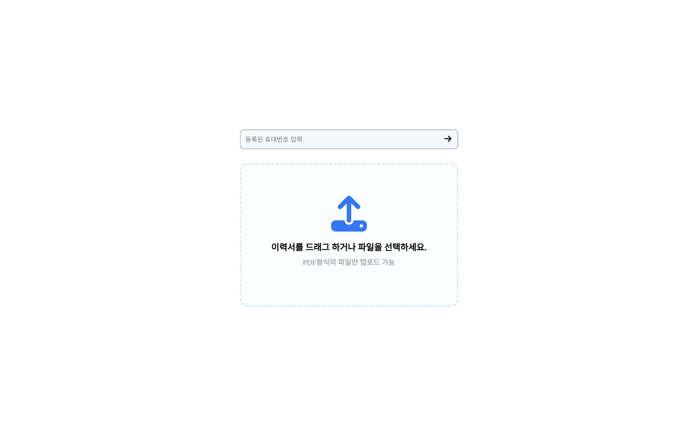
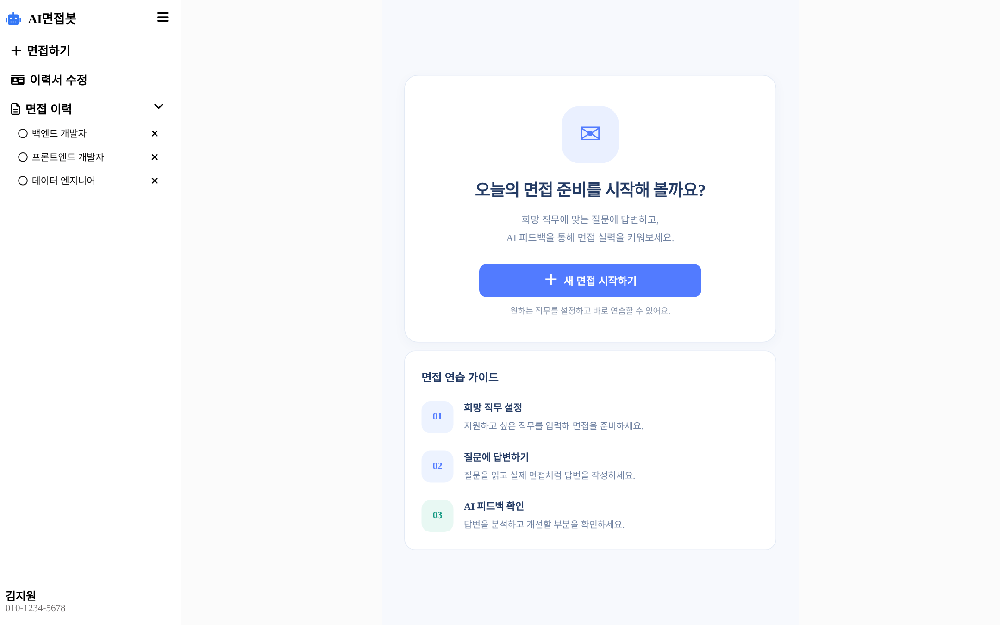
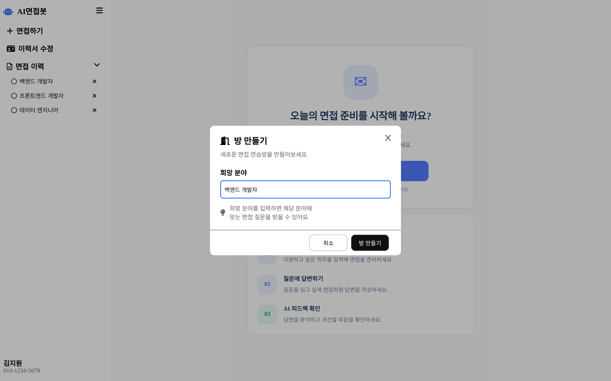
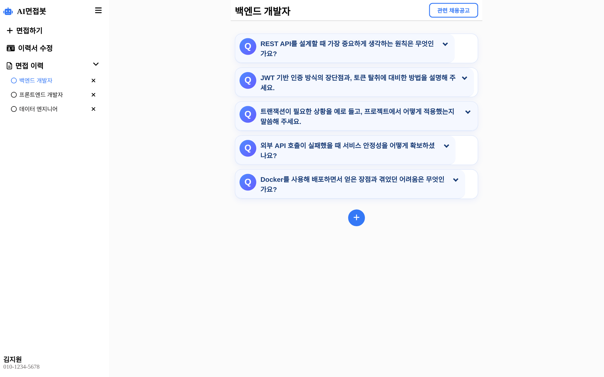
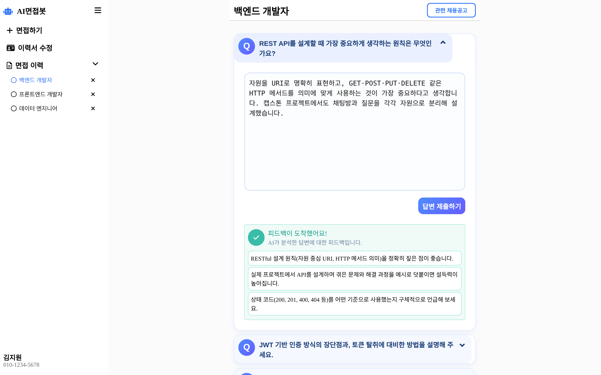

# 답변연습소 (AI 면접봇)

컴퓨터소프트웨어학과 캡스톤 디자인 프로젝트

이력서와 희망 직무를 바탕으로 AI가 면접 질문을 만들어 주고, 사용자가 작성한 답변에 피드백을 주는 면접 연습 웹 서비스입니다.

## 화면

| 이력서 업로드 | 메인 화면 |
|:---:|:---:|
|  |  |

| 면접방 만들기 | 면접 질문 목록 |
|:---:|:---:|
|  |  |

| 답변 피드백 |
|:---:|
|  |

## 주요 기능

**이력서 등록**
- PDF 이력서를 올리면 Gemini가 내용을 분석해서 이름, 학력, 경력 등 사용자 정보를 저장
- 이미 등록한 사용자는 휴대폰 번호로 바로 접속

**면접방 생성**
- 희망 분야(예: 백엔드 개발자)를 입력하면 면접방이 만들어지고, 이력서 정보를 반영한 질문 5개가 생성됨
- `+` 버튼으로 기존 질문과 겹치지 않는 질문을 추가로 생성
- 사람인 채용공고 검색으로 바로 이동하는 버튼

**답변 피드백**
- 질문마다 답변을 작성해서 제출하면 AI 피드백을 받을 수 있음
- 답변과 피드백은 DB에 저장되어 나중에 다시 확인 가능

**면접 이력**
- 사이드바에서 지금까지 만든 면접방 목록 확인 및 삭제

## 기술 스택

| 구분 | 사용 기술 |
|---|---|
| Frontend | React 19, Vite, React Router, TanStack Query, Jotai, Axios |
| Backend | Node.js, Express 5, Prisma, Multer |
| DB | MySQL |
| 인증 | JWT (쿠키) |
| AI | Google Gemini API (gemini-2.5-flash) |
| 배포 | Docker, Docker Hub, Kubernetes |

## 구조

```
capstone
├── frontend
│   └── src
│       ├── page        # 화면 (이력서 업로드, 홈, 면접방)
│       ├── components  # 모달, 로딩
│       ├── service     # API 호출
│       ├── network     # axios 설정
│       └── store       # Jotai 상태
├── backend
│   ├── routes          # /auth, /chatroom, /question
│   ├── controls
│   ├── services        # AI 호출, 비즈니스 로직
│   ├── data            # DB 접근
│   ├── middleware      # 인증
│   ├── prisma          # 스키마, 마이그레이션
│   └── utils
├── kubernetes          # backend / frontend / mysql 배포 yaml
└── deploy-frontend.ps1 # 프론트 이미지 빌드 및 배포 스크립트
```

## API

| Method | URL | 설명 |
|---|---|---|
| POST | `/auth/resume` | 이력서 업로드 및 분석 |
| POST | `/auth` | 휴대폰 번호로 사용자 조회 |
| GET | `/chatroom` | 면접방 목록 |
| GET | `/chatroom/:id` | 면접방 상세 (질문 포함) |
| POST | `/chatroom` | 면접방 생성 |
| DELETE | `/chatroom/:id` | 면접방 삭제 |
| POST | `/question` | 질문 추가 생성 |
| POST | `/question/feedback` | 답변 피드백 요청 |

## 실행 방법

### 환경 변수

`backend/.env`

```
CLIENT_HOST=
MYSQL_USER=
MYSQL_PASSWORD=
MYSQL_HOST=
MYSQL_DATABASE=
MYSQL_PORT=
DATABASE_URL=
SESSION_TEXT=
JWT_SECRET_KEY=
GEMINI_API_KEY=
```

### 로컬 실행

```bash
# backend
cd backend
npm install
npx prisma generate
npm run dev

# frontend
cd frontend
npm install
npm run dev
```

### Docker

```bash
docker build -t capstone-backend ./backend
docker build -t capstone-frontend ./frontend

docker run -d -p 3000:3000 --env-file backend/.env capstone-backend
docker run -d -p 5173:5173 capstone-frontend
```

### Kubernetes

```bash
kubectl apply -f kubernetes/sql
kubectl apply -f kubernetes/backend
kubectl apply -f kubernetes/frontend
```

`secret.yaml`은 저장소에 포함되어 있지 않으므로 직접 만들어서 적용해야 합니다.

## 개발하면서 겪은 문제

- **Gemini 무료 사용량 초과**
  무료 API 키는 요청 횟수 제한이 있어서 시연 중에 응답이 끊기는 경우가 있었습니다. 서버에서 429 에러가 나면 프론트에서 API 키 발급 페이지로 이동하도록 처리했습니다.

- **AI 응답 형식이 매번 다름**
  JSON으로 달라고 해도 앞뒤에 설명이 붙어서 오는 경우가 많아서, 응답에서 JSON 부분만 뽑아내는 미들웨어(`json.middleware.js`)를 따로 만들었습니다.

- **면접방 생성 중 오류 시 데이터 꼬임**
  질문 생성에 실패하면 빈 면접방만 남는 문제가 있어서, 면접방 생성과 질문 저장을 Prisma 트랜잭션으로 묶었습니다.
