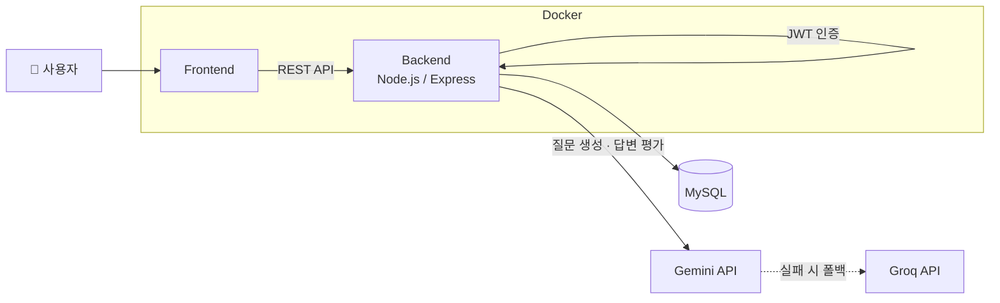
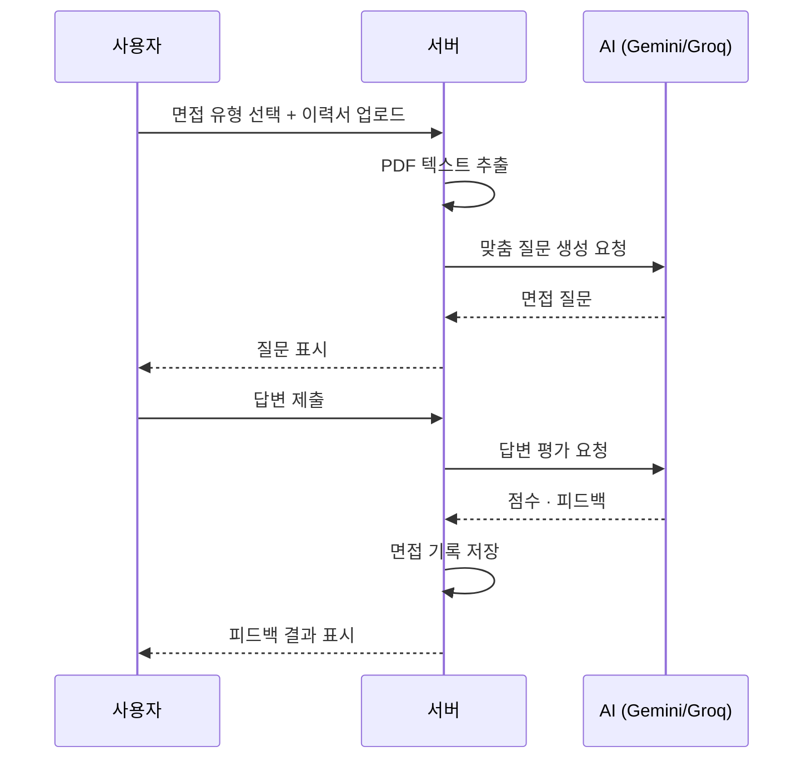

<div align="center">

# 🎤 답변연습소

### AI 기반 모의 면접 코칭 서비스

**질문부터 피드백까지, AI 면접관과 함께하는 실전 면접 연습**

<br/>


컴퓨터소프트웨어학과 캡스톤 디자인

</div>

<br/>

## 📌 목차

1. [프로젝트 소개](#-프로젝트-소개)
2. [주요 기능](#-주요-기능)
3. [서비스 화면](#-서비스-화면)
4. [시스템 아키텍처](#-시스템-아키텍처)
5. [기술 스택](#-기술-스택)
6. [프로젝트 구조](#-프로젝트-구조)
7. [시작하기](#-시작하기)
8. [트러블슈팅](#-트러블슈팅)

<br/>

## 💡 프로젝트 소개

### 배경

취업 준비생에게 면접은 가장 큰 관문이지만, 실전처럼 연습하고 **객관적인 피드백**을 받을 기회는 많지 않습니다.
스터디는 일정 맞추기가 어렵고, 유료 컨설팅은 비용 부담이 큽니다.

### 목표

**답변연습소**는 AI가 면접관 역할을 맡아 언제든 혼자서도 실전 같은 면접을 연습할 수 있도록 돕습니다.

- 🎯 **나에게 맞는 질문** : 이력서와 지원 분야를 바탕으로 질문 생성
- 📝 **구체적인 피드백** : 답변의 강점과 개선점을 AI가 분석
- 📈 **눈에 보이는 성장** : 면접 기록과 점수 변화를 한눈에 확인

<br/>

## ✨ 주요 기능

### 1. 회원 인증
- JWT 기반 회원가입 / 로그인
- 사용자별 면접 기록 분리 관리

### 2. 맞춤형 AI 면접

| 면접 유형 | 설명 |
|:---:|---|
| 💻 **기술 면접** | 직무 관련 CS·기술 지식 질문 |
| 🙋 **인성 면접** | 경험·가치관 중심의 행동 질문 |
| 🧩 **케이스 면접** | 상황 판단·문제 해결 능력 질문 |

- **이력서 PDF 업로드** 시 텍스트를 추출해 이력서 기반 꼬리질문 생성

### 3. AI 답변 평가
- 답변 내용 분석 후 **점수 + 강점 + 개선점** 제공
- 더 나은 답변 방향 제시

### 4. 면접 기록 관리
- 지난 면접 질문·답변·피드백 다시 보기
- 점수 변화로 성장 과정 확인

<br/>

## 🏗 시스템 아키텍처



### 면접 진행 흐름



<br/>

## 🛠 기술 스택

| 구분 | 기술 |
|:---:|---|
| **Frontend** | (사용한 프레임워크 입력) |
| **Backend** | Node.js, Express |
| **Database** | MySQL |
| **Auth** | JWT |
| **AI** | Google Gemini API, Groq API (Fallback) |
| **Infra** | Docker |
| **Collaboration** | Git, GitHub |

<br/>

## 📁 프로젝트 구조

```
capstone-project/
├── frontend/          # 클라이언트
│   └── Dockerfile
├── backend/           # API 서버
│   ├── routes/        # 라우터
│   ├── controllers/   # 비즈니스 로직
│   ├── models/        # DB 모델
│   ├── middlewares/   # JWT 인증 등
│   └── Dockerfile
└── README.md
```

> 실제 폴더 구조에 맞게 수정해 주세요.

<br/>

## 🚀 시작하기

### 1. 저장소 클론

```bash
git clone https://github.com/hyunjun041002/capstone-project.git
cd capstone-project
```

### 2. 환경 변수 설정

`backend/.env`

```env
PORT=
DB_HOST=
DB_USER=
DB_PASSWORD=
DB_NAME=
JWT_SECRET=
GEMINI_API_KEY=
GROQ_API_KEY=
```

### 3. 로컬 실행

```bash
# Backend
cd backend
npm install
npm start

# Frontend (새 터미널)
cd frontend
npm install
npm start
```

### 4. Docker로 실행

```bash
docker build -t capstone-backend ./backend
docker build -t capstone-frontend ./frontend

docker run -d -p 3000:3000 --env-file backend/.env capstone-backend
docker run -d -p 80:80 capstone-frontend
```

<br/>

## 🔧 트러블슈팅

<details>
<summary><b>AI 무료 토큰 한도 초과 문제</b></summary>
<br/>

**문제** : 무료 AI API 사용량 한도로 인해 요청이 실패하는 경우 발생

**해결** : Gemini API를 기본으로 사용하고, 실패 시 Groq API로 자동 전환하는 **폴백 구조** 적용

</details>

<details>
<summary><b>이력서 기반 질문 생성</b></summary>
<br/>

**문제** : PDF 파일을 AI에 그대로 전달하기 어려움

**해결** : 서버에서 PDF 텍스트를 추출한 뒤 프롬프트에 포함해 맞춤 질문 생성

</details>

<br/>

<div align="center">

**답변연습소** · 컴퓨터소프트웨어학과 캡스톤 디자인

</div>
