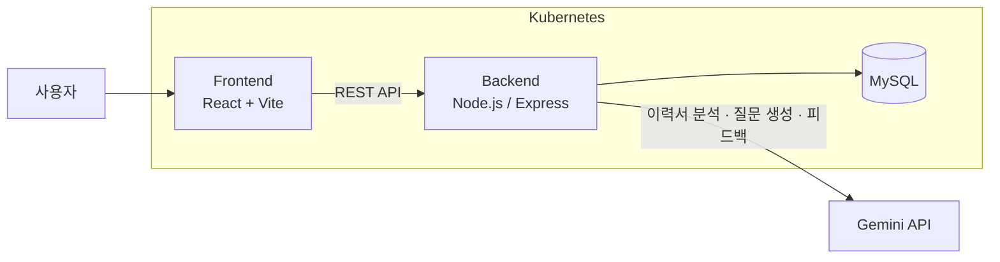
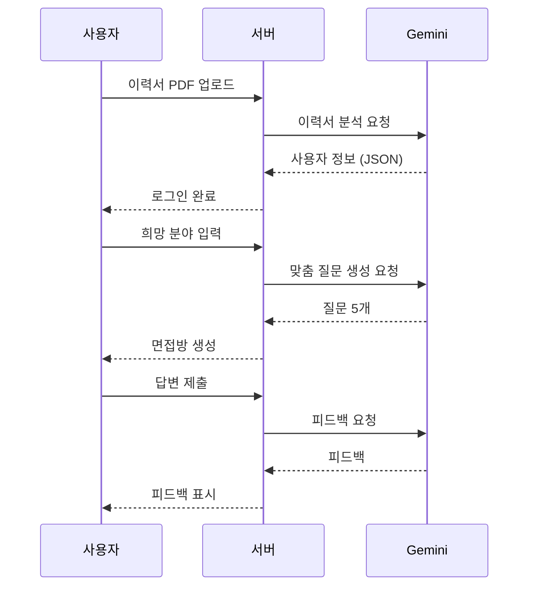

# 답변연습소

AI 기반 모의 면접 연습 서비스

컴퓨터소프트웨어학과 캡스톤 디자인 프로젝트

<br/>

## 목차

1. [프로젝트 소개](#프로젝트-소개)
2. [주요 기능](#주요-기능)
3. [시스템 구조](#시스템-구조)
4. [기술 스택](#기술-스택)
5. [프로젝트 구조](#프로젝트-구조)
6. [API](#api)
7. [실행 방법](#실행-방법)

<br/>

## 프로젝트 소개

### 배경

면접 준비를 할 때 실전처럼 연습하고 피드백을 받을 기회가 생각보다 많지 않습니다.
스터디는 일정을 맞추기 어렵고, 유료 컨설팅은 비용 부담이 있습니다.

### 목표

이력서와 희망 직무를 입력하면 AI가 나에게 맞는 면접 질문을 만들어 주고,
답변을 작성하면 바로 피드백을 받을 수 있는 서비스를 만드는 것을 목표로 했습니다.

- 이력서 내용을 반영한 맞춤 질문 생성
- 답변에 대한 AI 피드백 제공
- 면접 기록을 저장해서 다시 확인 가능


<br/>
## 주요 기능

### 1. 이력서 등록

- PDF 이력서를 업로드하면 Gemini가 이력서를 분석해 이름, 학력, 경력, 프로젝트, 기술 스택을 DB에 저장
- 이미 등록한 사용자는 휴대폰 번호로 바로 접속
- 로그인 상태는 JWT 쿠키로 유지

### 2. 면접방 생성

| 기능 | 설명 |
|---|---|
| 면접방 만들기 | 희망 분야(예: 백엔드 개발자)를 입력하면 이력서 정보를 반영한 질문 5개 생성 |
| 질문 추가 | 기존 질문과 겹치지 않는 질문을 5개씩 추가 생성 |
| 관련 채용공고 | 희망 분야로 사람인 채용공고 검색 페이지로 이동 |

### 3. 답변 피드백

- 질문마다 답변을 작성해서 제출하면 AI가 답변을 분석해 피드백 제공
- 답변과 피드백은 DB에 저장되어 나중에 다시 확인 가능

### 4. 면접 이력 관리

- 사이드바에서 지금까지 만든 면접방 목록 확인
- 필요 없는 면접방 삭제

<br/>

## 시스템 구조



### 면접 진행 흐름



<br/>

## 기술 스택

| 구분 | 사용 기술 |
|---|---|
| Frontend | React 19, Vite, React Router, TanStack Query, Jotai, Axios |
| Backend | Node.js, Express 5, Prisma, Multer |
| Database | MySQL |
| Auth | JWT (Cookie) |
| AI | Google Gemini API (gemini-2.5-flash) |
| Infra | Docker, Docker Hub, Kubernetes |
| 협업 | Git, GitHub |

<br/>

## 프로젝트 구조

```
capstone
├── frontend
│   └── src
│       ├── page          # 이력서 업로드, 홈, 면접방 화면
│       ├── components    # 모달, 로딩
│       ├── service       # API 호출
│       ├── network       # axios 설정
│       └── store         # Jotai 상태 관리
├── backend
│   ├── routes            # /auth, /chatroom, /question
│   ├── controls
│   ├── services          # AI 호출, 비즈니스 로직
│   ├── data              # DB 접근
│   ├── middleware        # JWT 인증, JSON 추출
│   ├── prisma            # 스키마, 마이그레이션
│   └── utils
├── kubernetes            # backend / frontend / mysql 배포 yaml
├── docs/images           # README 스크린샷
└── deploy-frontend.ps1   # 프론트엔드 이미지 빌드 및 배포 스크립트
```

<br/>

## API

| Method | URL | 설명 |
|---|---|---|
| POST | `/auth/resume` | 이력서 업로드 및 분석 |
| POST | `/auth` | 휴대폰 번호로 사용자 조회 |
| GET | `/chatroom` | 면접방 목록 조회 |
| GET | `/chatroom/:id` | 면접방 상세 조회 (질문 포함) |
| POST | `/chatroom` | 면접방 생성 |
| DELETE | `/chatroom/:id` | 면접방 삭제 |
| POST | `/question` | 질문 추가 생성 |
| POST | `/question/feedback` | 답변 피드백 요청 |

<br/>

## 실행 방법

### 1. 저장소 클론

```bash
git clone https://github.com/hyunjun041002/capstone-project.git
cd capstone-project
```

### 2. 환경 변수 설정

`backend/.env`

```
CLIENT_HOST=
MYSQL_USER=
MYSQL_PASSWORD=
MYSQL_HOST=
MYSQL_DATABASE=
MYSQL_PORT=
DATABASE_URL=
SESSION_TEXT=
JWT_SECRET_KEY=
GEMINI_API_KEY=
```

### 3. 로컬 실행

```bash
# Backend
cd backend
npm install
npx prisma generate
npm run dev

# Frontend (새 터미널)
cd frontend
npm install
npm run dev
```

### 4. Docker 실행

```bash
docker build -t capstone-backend ./backend
docker build -t capstone-frontend ./frontend

docker run -d -p 3000:3000 --env-file backend/.env capstone-backend
docker run -d -p 5173:5173 capstone-frontend
```

### 5. Kubernetes 배포

```bash
kubectl apply -f kubernetes/sql
kubectl apply -f kubernetes/backend
kubectl apply -f kubernetes/frontend
```

`secret.yaml`은 저장소에 포함되어 있지 않으므로 직접 작성해서 적용해야 합니다.

<br/>
